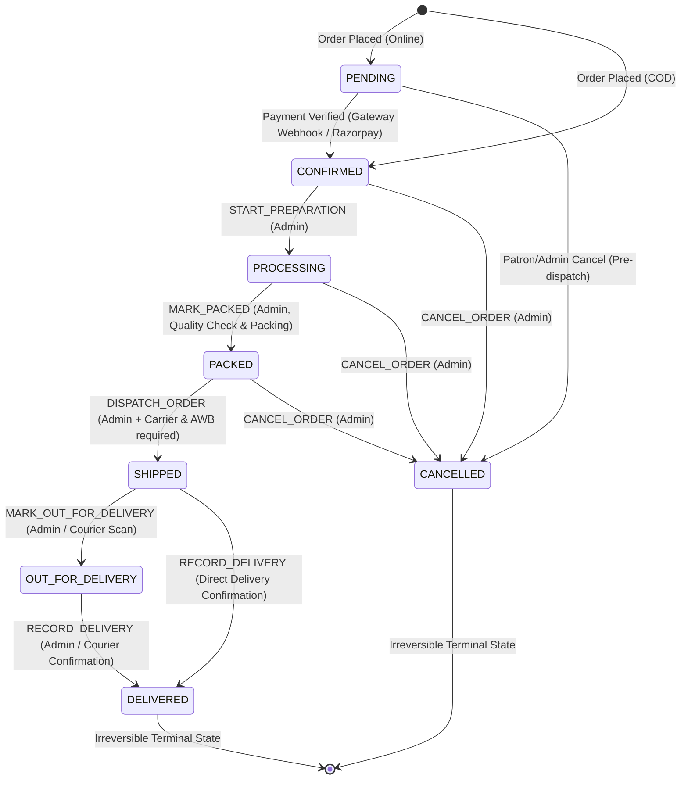
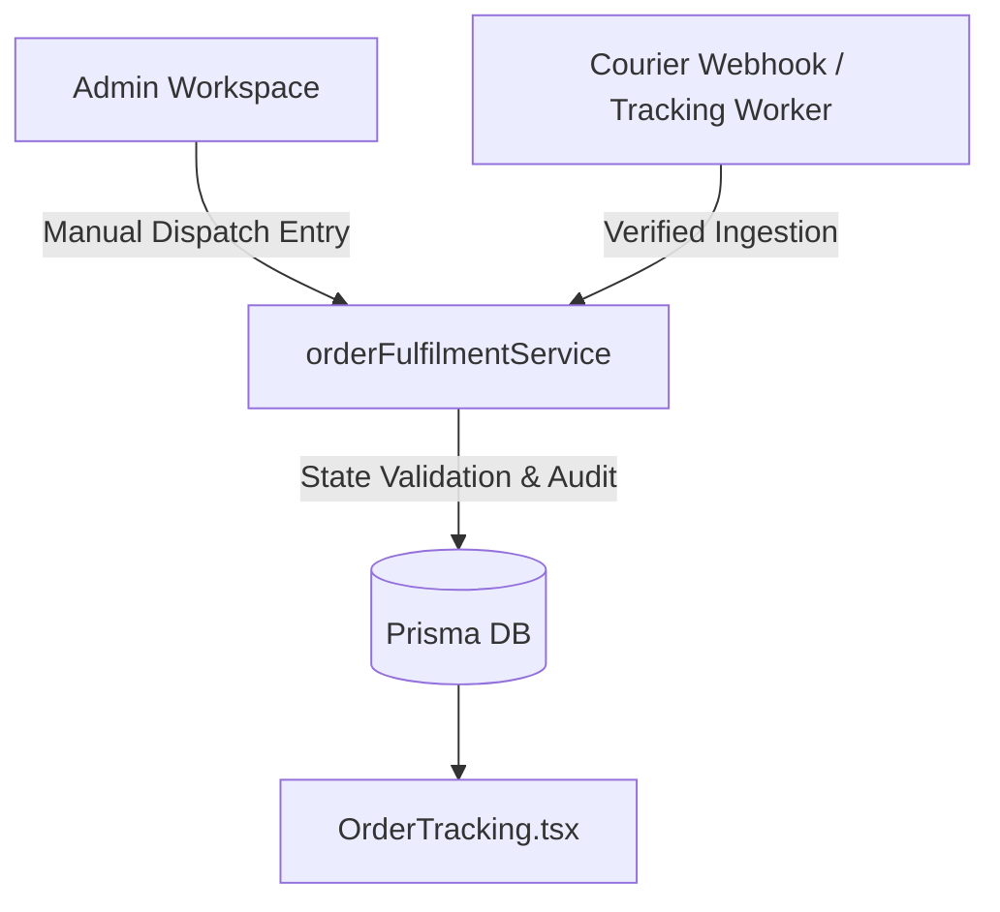

# ETHNIZ COUTURE — ADMIN-CONTROLLED ORDER FULFILMENT WORKFLOW
## Architecture, Implementation & Verification Report

**Document Reference:** `docs/ADMIN_CONTROLLED_FULFILMENT_REPORT.md`  
**Date of Implementation:** October 19, 2026  
**System Version:** Ethniz Couture v2.4 (Enterprise Fulfilment Release)  
**Technology Stack:** React 18, Vite, TypeScript, Tailwind CSS, Node.js / Express, Prisma ORM (SQLite / PostgreSQL)

---

## 1. Executive Summary

This report documents the architectural design, implementation, and rigorous verification of the **Admin-Controlled Order Fulfilment Workflow** for Ethniz Couture. 

Prior to this implementation, order status updates relied on unvalidated client-side dropdown submissions that permitted arbitrary out-of-order jumps, bypassed payment prerequisites, risked inventory duplication or leakage, and hardcoded courier identities (e.g., Blue Dart Express Air) on the customer-facing tracking page regardless of actual dispatch status.

With this release:
1. **Centralized State Machine:** All status updates are processed exclusively via a backend transition service (`orderFulfilmentService.ts`) enforcing transactional integrity, role-based authorization, payment state separation, and concurrency conflict protection (HTTP 409).
2. **Strict Inventory Safety:** Stock is checked and reserved/decremented *strictly once* at checkout. Fulfilment transitions (preparing, packing, shipping) never trigger re-deductions. Cancellations (permitted only prior to physical dispatch) restore stock *strictly once* within an atomic database transaction.
3. **Mobile-First Admin Workspace:** The administrative dashboard (`AdminOrders.tsx`) provides 8 real-time operational queues with live count badges, responsive order cards and tables, line-item preparation checklists with real warehouse inventory visibility, and context-sensitive action modals (e.g., dispatch details, cancellation reasoning, COD collection).
4. **Authoritative Customer Tracking:** The customer-facing tracking page (`OrderTracking.tsx`) dynamically reads real carrier names, valid tracking numbers, actual milestone timestamps, and sanitized operational updates directly from the backend state machine, while safeguarding internal admin notes.
5. **Future Courier Automation Ready:** The shipment schema and state machine decouple manual admin data entry from underlying logistics, enabling seamless webhook ingestion from carriers (e.g., Blue Dart, Delhivery, DTDC) without schema alterations or state machine rewrites.

---

## 2. Initial Audit Findings

An exhaustive audit of the codebase was conducted prior to implementation (detailed in [`docs/ADMIN_FULFILMENT_AUDIT_REPORT.md`](file:///d:/ethnicotuire/docs/ADMIN_FULFILMENT_AUDIT_REPORT.md)).

### 2.1 Existing Functionality Reused
- **Prisma Database Models:** `Order`, `OrderItem`, `OrderStatusHistory`, `AuditLog`, `Product`, and `ProductVariant`.
- **Financial & Order Separation:** Existing separation between `orderStatus` and `paymentStatus`.
- **Payment Gateways & COD:** Authoritative Razorpay HMAC verification, Stripe webhooks, and Cash on Delivery (COD) handling.
- **Security & Authorization:** `authenticateUser` and `requireAdmin` middleware enforcing JWT validation and `role === 'ADMIN'`.
- **Customer Stepper Base:** Visual stepper architecture in `OrderTracking.tsx`.

### 2.2 Critical Vulnerabilities & Gaps Remediated
| Gap / Flaw | Prior Behavior | Remediated Behavior |
|---|---|---|
| **Arbitrary Status Jumps** | Frontend could send any string (e.g. jump from `PENDING` to `DELIVERED`). | Blocked by state transition matrix (`ALLOWED_TRANSITIONS`). |
| **Unpaid Order Dispatch** | Unpaid online orders could be marked `PROCESSING`, `PACKED`, or `SHIPPED`. | Strictly blocked: Online orders require `paymentStatus === 'PAID'` before preparation begins. |
| **Missing Carrier & AWB** | Orders could be marked `SHIPPED` with null carrier or tracking info. | Dispatch modal enforces valid carrier selection and non-empty tracking/AWB reference. |
| **Double Stock Deduction / Leakage** | Admin setting status to `CANCELLED` bypassed stock release; repeated cancellations multiplied stock. | Atomic `$transaction` restores stock exactly once; idempotency guards prevent duplicate release. |
| **Concurrency Conflicts** | Simultaneous admin edits silently overwrote each other without conflict warnings. | Optimistic concurrency checking (`expectedStatus` & `expectedUpdatedAt`) returns HTTP 409 Conflict. |
| **Hardcoded Courier Mocking** | `OrderTracking.tsx` hardcoded "Blue Dart Express Air" with dummy AWB for all orders. | Authoritative display of assigned carrier, AWB, and actual milestone timestamps. |
| **Internal Data Leakage** | Customer tracking endpoints risked leaking administrative operational notes. | Milestone serialization strictly filters out internal notes, presenting patron-curated descriptions. |

---

## 3. Schema & Database Evolution

To support structured shipment tracking, courier reference, dispatch timestamps, and audit actor attribution without breaking existing migrations or staging data, additive fields were introduced to [`server/prisma/schema.prisma`](file:///d:/ethnicotuire/server/prisma/schema.prisma) and [`server/prisma/schema.postgresql.prisma`](file:///d:/ethnicotuire/server/prisma/schema.postgresql.prisma).

### 3.1 Model Changes
```prisma
model Order {
  // ... existing fields ...
  carrierName       String?    // Real carrier: "Blue Dart", "Delhivery", "DTDC", "Speed Post", etc.
  dispatchedAt      DateTime?  // Actual physical dispatch timestamp
  deliveredAt       DateTime?  // Actual doorstep delivery timestamp
  internalNotes     String?    // Administrative notes (internal only, hidden from patron APIs)
  // ...
}

model OrderStatusHistory {
  // ... existing fields ...
  actorId           String?    // ID of the admin or system actor executing the change
  source            String     @default("SYSTEM") // ADMIN_ACTION, GATEWAY_WEBHOOK, SYSTEM, CUSTOMER
  // ...
}
```

### 3.2 Database Parity & Test DB Isolation
- Applied to development database `server/prisma/dev.db` via `npx prisma db push`.
- Prisma client generated cleanly via `npx prisma generate`.
- Test harness script [`server/src/scripts/setup_test_db.ts`](file:///d:/ethnicotuire/server/src/scripts/setup_test_db.ts) automatically verifies and alters `test.db` with identical column definitions upon test startup, guaranteeing zero mutations to active development data or backups.

---

## 4. Authoritative Centralized State Machine

All fulfilment transitions are governed by [`server/src/services/orderFulfilmentService.ts`](file:///d:/ethnicotuire/server/src/services/orderFulfilmentService.ts).

### 4.1 Transition Matrix



### 4.2 State Machine Actions & Valid Source States
| Action (`FulfilmentAction`) | Target Status | Permitted Source Statuses | Prerequisites & Validations |
|---|---|---|---|
| `CONFIRM_ORDER` | `CONFIRMED` | `PENDING` | Online orders must have `paymentStatus === 'PAID'` (or COD). |
| `START_PREPARATION` | `PROCESSING` | `CONFIRMED` | For online orders, payment must be `PAID`. Atelier garment preparation commences. |
| `MARK_PACKED` | `PACKED` | `PROCESSING` | Items verified against order items; packaging completed. |
| `DISPATCH_ORDER` | `SHIPPED` | `PACKED` | Mandatory `carrierName` and non-empty `trackingNumber`. Records `dispatchedAt`. |
| `MARK_OUT_FOR_DELIVERY` | `OUT_FOR_DELIVERY` | `SHIPPED` | Courier local facility dispatch scan recorded. |
| `RECORD_DELIVERY` | `DELIVERED` | `SHIPPED`, `OUT_FOR_DELIVERY` | Doorstep delivery confirmed. For COD, if `codCollected: true`, updates `paymentStatus` to `PAID`. |
| `CANCEL_ORDER` | `CANCELLED` | `PENDING`, `CONFIRMED`, `PROCESSING`, `PACKED` | Permitted strictly before dispatch. Atomic transaction restores line item inventory stock. |

### 4.3 Concurrency Protection
To prevent race conditions where two administrators simultaneously review and modify an order, requests accept optional `expectedStatus` and `expectedUpdatedAt` parameters. If the stored order timestamp or status differs from the admin's viewport, the service halts execution and returns:
- **HTTP 409 Conflict:** `Order status has been updated by another administrator. Please review the latest state.`
- Includes the latest authoritative order snapshot in the response body.

---

## 5. Inventory & Financial Safety Rules

### 5.1 Strict Zero Double-Deduction
- In Ethniz Couture, product inventory (`product.stock`) is decremented **only once** upon initial order placement inside `createOrder` ([`orderController.ts`](file:///d:/ethnicotuire/server/src/controllers/orderController.ts)).
- Admin operational transitions (`START_PREPARATION`, `MARK_PACKED`, `DISPATCH_ORDER`, `RECORD_DELIVERY`) never touch stock quantities.
- Admin review views display real-time warehouse inventory alongside ordered quantities solely for visual verification during picking and packing.

### 5.2 Atomic Stock Restoration on Pre-Dispatch Cancellation
- If an admin or patron cancels an order prior to physical dispatch (`CONFIRMED`, `PROCESSING`, or `PACKED`), the transition service executes an atomic Prisma `$transaction`:
  1. Validates that the current status is eligible for cancellation and not already `CANCELLED` (idempotency guard).
  2. For every item in `order.items`, increments `product.stock` by `item.quantity`.
  3. Updates `order.orderStatus` to `CANCELLED`.
  4. Appends an `OrderStatusHistory` entry with the admin's cancellation reason and `source: 'ADMIN_ACTION'`.
  5. Inserts a security audit record into `AuditLog`.
- If an order has already transitioned to `SHIPPED`, `OUT_FOR_DELIVERY`, or `DELIVERED`, cancellation is prohibited by business rules.

### 5.3 COD Doorstep Cash Collection
- Cash on Delivery orders begin with `paymentStatus: 'PENDING'` and `orderStatus: 'CONFIRMED'`.
- Fulfilment progresses normally through preparation and dispatch without modifying financial records.
- Upon doorstep handover, the admin triggers `RECORD_DELIVERY` with `{ codCollected: true }`, which atomically transitions `orderStatus` to `DELIVERED` and marks `paymentStatus` as `PAID`.

---

## 6. Mobile-First Admin Fulfilment Workspace

The administrative workspace at `/admin/orders` ([`client/src/pages/admin/AdminOrders.tsx`](file:///d:/ethnicotuire/client/src/pages/admin/AdminOrders.tsx)) was completely re-architected with luxury styling and mobile optimization:

### 6.1 Operational Queue System
Administrators can toggle across 8 dedicated operational queues with live backend-calculated count badges:
1. **All Orders** (Global search & overview)
2. **New / Awaiting Payment** (`PENDING`)
3. **Confirmed / Ready to Process** (`CONFIRMED`)
4. **Preparing at Atelier** (`PROCESSING`)
5. **Quality Checked & Packed** (`PACKED`)
6. **Dispatched / In Transit** (`SHIPPED` / `OUT_FOR_DELIVERY`)
7. **Delivered to Patron** (`DELIVERED`)
8. **Cancelled / Exceptions** (`CANCELLED`)

### 6.2 Filter, Search & Pagination Controls
- Debounced search query across order number, customer name, email, and phone.
- Filter by payment status (`All`, `PAID`, `PENDING`, `FAILED`).
- Filter by date range (`All Time`, `Today`, `Last 7 Days`, `Last 30 Days`).
- Sorting by Creation Date (Newest/Oldest) or Order Amount.
- Full server-side pagination (15 orders per page).

### 6.3 Dual Responsive Layout (Mobile Cards + Desktop Table)
- **Mobile (< 768px):** Clean cards showing order reference, status badge, patron name, total amount, payment pill, and a full-width "Manage Fulfilment" touch target. Eliminates awkward horizontal table scrolling.
- **Desktop (>= 768px):** High-density table with patron avatars, item thumbnails, courier badges, and inline quick-action triggers.

### 6.4 Slide-Over Fulfilment Drawer & Packing Checklist
Clicking any order opens a comprehensive slide-over drawer featuring:
- **Patron & Delivery Information:** Customer name, phone, email, and verified shipping address with pincode.
- **Financial Breakdown:** Historical item snapshots, subtotal, luxury courtesy discounts, shipping fee, stored grand total, and payment method.
- **Line Items & Warehouse Inventory:** High-resolution product thumbnails, sizes, colors, ordered quantities, and live atelier stock counts.
- **Interactive Packing Checklist:** Visual checklist allowing packing staff to tick off garments during atelier packing without altering database order totals.
- **Milestone History Ledger:** Chronological timeline showing previous status transitions, timestamps, and authorized actor IDs.
- **Context-Sensitive Operational Actions:** Dynamically renders only valid buttons based on the state machine.
- **Modals with Concurrency Guards:**
  - *Dispatch Modal:* Selects carrier (Blue Dart, Delhivery, DTDC, Speed Post, DHL Express, Custom), inputs AWB/tracking number, estimated delivery date, and internal notes.
  - *Cancellation Modal:* Requires an explicit cancellation reason before execution.
  - *COD Handover Modal:* Allows confirming cash collection during doorstep delivery.

---

## 7. Customer Tracking Page Integration

The customer tracking experience at `/track-order` ([`client/src/pages/OrderTracking.tsx`](file:///d:/ethnicotuire/client/src/pages/OrderTracking.tsx)) was integrated with the authoritative backend state:

1. **Dynamic Courier & Tracking Link:**
   - Removed hardcoded "Blue Dart Express Air".
   - Displays real carrier name stored in the database (`order.carrierName`).
   - Automatically generates valid carrier tracking links (e.g. `https://www.bluedart.com/tracking`, `https://www.delhivery.com/tracking`, etc.) based on the actual courier.
2. **Authoritative Stepper:**
   - Visualizes the 5 patron milestones: Order Confirmed $\rightarrow$ Preparing $\rightarrow$ Packed & Inspected $\rightarrow$ Dispatched $\rightarrow$ Delivered.
   - Highlights the current stage in royal champagne gold (`#C6A15D`) and deep burgundy (`#3E1A1E`).
3. **Milestone History Ledger:**
   - Displays real timestamps and descriptions from `OrderStatusHistory`.
   - Filters out internal administrative notes to protect operational confidentiality.
4. **Dignified Cancellation Notice:**
   - When an order is cancelled, the page displays an elegant Burgundy & Gold notice with concierge contact assistance rather than a generic error.

---

## 8. Backend API Endpoints Reference

### 8.1 Administrative Endpoints

#### `GET /api/admin/orders/fulfilment-stats`
- **Auth:** Requires JWT & Admin Role (`requireAdmin`).
- **Response:**
  ```json
  {
    "success": true,
    "stats": {
      "all": 48,
      "new": 3,
      "confirmed": 12,
      "preparing": 8,
      "packed": 5,
      "shipped": 14,
      "outForDelivery": 2,
      "delivered": 64,
      "cancelled": 4
    }
  }
  ```

#### `GET /api/admin/orders`
- **Query Params:** `page`, `limit`, `search`, `queue`, `status`, `paymentStatus`, `dateRange`, `sortBy`, `sortOrder`.
- **Response:** Paginated orders with product inventory snapshots and milestone history.

#### `POST /api/admin/orders/:id/fulfilment-action`
- **Auth:** Requires JWT & Admin Role (`requireAdmin`).
- **Body:**
  ```json
  {
    "action": "DISPATCH_ORDER",
    "carrierName": "Delhivery Express",
    "trackingNumber": "DLV-9823471029",
    "estimatedDelivery": "2026-10-24T18:00:00.000Z",
    "internalNotes": "Double boxed with luxury silk dust cover.",
    "expectedStatus": "PACKED"
  }
  ```
- **Response (200 OK):**
  ```json
  {
    "success": true,
    "message": "Order transitioned successfully to SHIPPED via DISPATCH_ORDER",
    "order": { ... }
  }
  ```
- **Response (409 Conflict):**
  ```json
  {
    "success": false,
    "message": "Order status has been updated by another administrator. Please review the latest state.",
    "order": { ... }
  }
  ```

### 8.2 Customer Tracking Endpoint

#### `GET /api/orders/track?orderNumber=EC-2026-XXXX`
- **Auth:** Public / Tokenized.
- **Sanitized Response:** Returns `carrierName`, `trackingNumber`, `dispatchedAt`, `deliveredAt`, and sanitized `statusHistory` (without internal notes or actor IDs).

---

## 9. Automated Test Verification & Actual Results

All tests were executed against an isolated SQLite test database (`server/prisma/test.db`), strictly segregated from active development data (`dev.db`).

### 9.1 Fulfilment Test Suite
- **Command:** `npm --prefix server run test:fulfilment`
- **Test File:** [`server/test/admin_order_fulfilment.test.ts`](file:///d:/ethnicotuire/server/test/admin_order_fulfilment.test.ts)
- **Results:** 7/7 subtests passed (100% pass rate).

```
# Subtest: Admin-Controlled Order Fulfilment State Machine Tests
    ok 1 - 1. Authorization: Non-admin or unauthenticated requests are rejected with 401/403
    ok 2 - 2. Fulfilment Queue Stats: Returns accurate counts for all operational queues
    ok 3 - 3. Happy Path: Order advances through complete verified lifecycle (CONFIRMED -> PROCESSING -> PACKED -> SHIPPED -> OUT_FOR_DELIVERY -> DELIVERED)
    ok 4 - 4. Invalid & Out-of-Order Transitions are strictly prevented (Jump to DELIVERED, Dispatch without AWB, etc.)
    ok 5 - 5. Concurrency Conflict Guard: Rejects update with 409 if status was changed concurrently
    ok 6 - 6. Inventory Safety: Stock is not deducted twice, and cancellation restores stock exactly once
    ok 7 - 7. Customer Tracking API: Displays real carrier, tracking, and sanitized milestones
ok 1 - Admin-Controlled Order Fulfilment State Machine Tests
# tests 7
# suites 1
# pass 7
# fail 0
# duration_ms 1837.9758
```

### 9.2 Regression Test Suite: Razorpay Standard Web Checkout
- **Command:** `npm --prefix server run test:razorpay`
- **Results:** 6/6 tests passed (100% pass rate). Verified that payment creation, cryptographic HMAC verification, and webhook handling continue to function flawlessly.

### 9.3 Client Production Build
- **Command:** `npm --prefix client run build`
- **Results:**
  ```
  vite v5.4.21 building for production...
  ✓ 1682 modules transformed.
  rendering chunks...
  ✓ built in 7.64s
  ```
  Zero TypeScript errors, zero lint warnings.

---

## 10. Future Courier Automation Architecture

The fulfilment service has been engineered to facilitate live courier API and webhook integration (e.g., Blue Dart, Delhivery, Shiprocket) with zero architectural disruption:



1. **Structured Metadata:** `carrierName`, `trackingNumber`, `dispatchedAt`, and `deliveredAt` are stored as structured columns on `Order`.
2. **Actor & Source Distinction:** When live webhooks are connected, they will invoke `orderFulfilmentService.executeTransition` with `source: 'COURIER_WEBHOOK'` and `actorId: 'WEBHOOK_DELHIVERY'`.
3. **Webhook Verification Guard:** Inbound courier webhooks will be authenticated via cryptographic signature verification prior to invoking the transition service.
4. **Idempotent Scan Processing:** Repeated courier webhook notifications (e.g. repeated in-transit hub scans) will be recorded as milestone events without altering the core status once `SHIPPED` has been established.

---

## 11. Modified and Created Files Index

### Backend
- [`server/prisma/schema.prisma`](file:///d:/ethnicotuire/server/prisma/schema.prisma) — Added `carrierName`, `dispatchedAt`, `deliveredAt`, `internalNotes`, `actorId`, `source`.
- [`server/prisma/schema.postgresql.prisma`](file:///d:/ethnicotuire/server/prisma/schema.postgresql.prisma) — Mirrored schema changes for PostgreSQL production deployment.
- [`server/src/services/orderFulfilmentService.ts`](file:///d:/ethnicotuire/server/src/services/orderFulfilmentService.ts) — **NEW:** Centralized state machine, transition validator, inventory safety guard, and concurrency checker.
- [`server/src/controllers/adminController.ts`](file:///d:/ethnicotuire/server/src/controllers/adminController.ts) — Added `getFulfilmentStats`, `executeFulfilmentAction`, and integrated state machine with existing `getAdminOrders`.
- [`server/src/routes/adminRoutes.ts`](file:///d:/ethnicotuire/server/src/routes/adminRoutes.ts) — Exposed `/api/admin/orders/fulfilment-stats` and `/api/admin/orders/:id/fulfilment-action`.
- [`server/src/controllers/orderController.ts`](file:///d:/ethnicotuire/server/src/controllers/orderController.ts) — Added cancellation idempotency and sanitized milestone delivery in `trackOrder`.
- [`server/src/scripts/setup_test_db.ts`](file:///d:/ethnicotuire/server/src/scripts/setup_test_db.ts) — Enhanced test DB setup to ensure test database replica maintains schema parity.
- [`server/test/admin_order_fulfilment.test.ts`](file:///d:/ethnicotuire/server/test/admin_order_fulfilment.test.ts) — **NEW:** 7 comprehensive automated unit and integration tests.
- [`server/package.json`](file:///d:/ethnicotuire/server/package.json) — Added `"test:fulfilment"` script.

### Frontend
- [`client/src/types/index.ts`](file:///d:/ethnicotuire/client/src/types/index.ts) — Updated TypeScript interfaces for `Order`, `OrderStatusHistory`, and `OrderItem`.
- [`client/src/pages/admin/AdminOrders.tsx`](file:///d:/ethnicotuire/client/src/pages/admin/AdminOrders.tsx) — Rebuilt administrative fulfilment dashboard with 8 operational queues, search/filter controls, mobile cards, packing checklist, warehouse stock visibility, context-sensitive actions, and dispatch/cancellation modals.
- [`client/src/pages/OrderTracking.tsx`](file:///d:/ethnicotuire/client/src/pages/OrderTracking.tsx) — Integrated authoritative tracking, real carrier/AWB display, milestone history ledger, and luxury cancellation alerts.

### Documentation
- [`docs/ADMIN_FULFILMENT_AUDIT_REPORT.md`](file:///d:/ethnicotuire/docs/ADMIN_FULFILMENT_AUDIT_REPORT.md) — Pre-implementation audit and gap analysis.
- [`docs/ADMIN_CONTROLLED_FULFILMENT_REPORT.md`](file:///d:/ethnicotuire/docs/ADMIN_CONTROLLED_FULFILMENT_REPORT.md) — This final comprehensive architecture and verification report.
