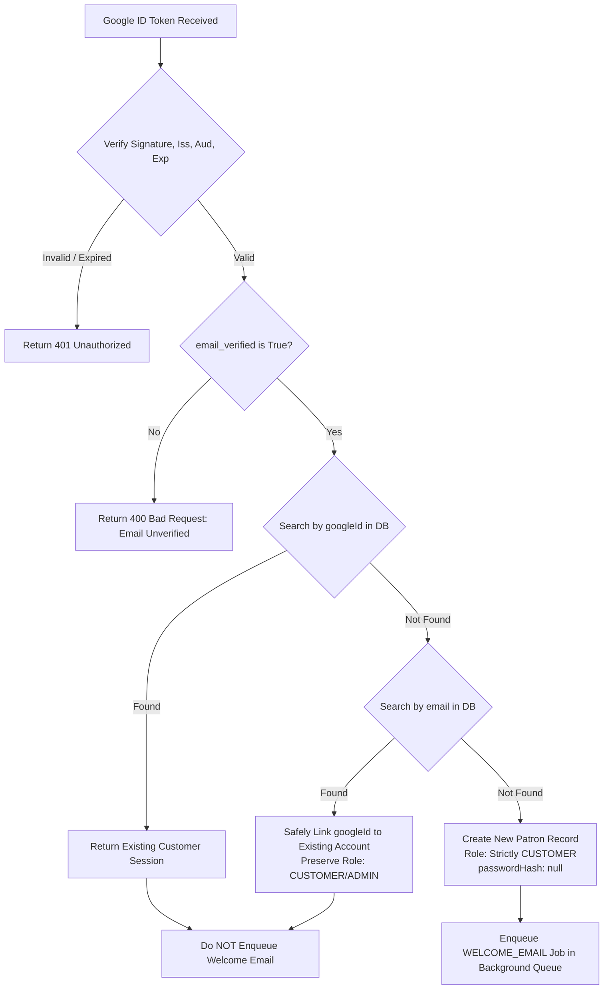

# ETHNIZ COUTURE — GOOGLE SIGN-IN + LUXURY WELCOME EMAIL EXPERIENCE

## EXECUTIVE SUMMARY

This report documents the implementation of secure **Google Sign-In** and an automated **Luxury Welcome Email Experience** for the Ethniz Couture e-commerce platform. The solution integrates seamlessly into the existing React 18 + Vite + TypeScript frontend, Express backend, Prisma ORM, and SQLite/PostgreSQL architecture without introducing external authentication monoliths (such as Firebase) or disrupting existing customer workflows.

Brand Identity:
- **Brand**: Ethniz Couture
- **Tagline**: *"Wear Your Heritage. Own Your Style."*
- **Primary Palette**: Deep burgundy (`#3E1A1E`), champagne gold (`#C6A15D`, `#DFC89D`), warm ivory (`#FAF7F2`), and refined neutrals.
- **Tone**: Warm, personal, elegant, contemporary, and welcoming.

---

## 1. EXISTING REUSED COMPONENTS & SYSTEM ARCHITECTURE

Rather than creating a secondary authentication system, the implementation directly builds upon Ethniz Couture's established, production-grade components:

| Component | Repository Path | Role & How It Was Reused |
| :--- | :--- | :--- |
| **Authentication Controller** | `server/src/controllers/authController.ts` | Reused existing JWT signing, password hashing (`bcryptjs`), input sanitization, and role validation. Added `googleAuth` controller. Added null-password safety in `login` and `adminLogin`. |
| **Authentication Routes** | `server/src/routes/authRoutes.ts` | Reused rate-limiting and route grouping. Added `POST /api/auth/google`. |
| **Authorization Middleware** | `server/src/middleware/auth.ts` | Reused token extraction and role enforcement. Reused `AuthRequest` contract. |
| **Prisma ORM & Models** | `server/prisma/schema.prisma` & `schema.postgresql.prisma` | Extended the baseline `User` model with `googleId`, `avatar`, `welcomeEmailSent`, `welcomeEmailSentAt`, and made `passwordHash` nullable for Google-only patrons. |
| **Background Job Infrastructure** | `server/src/services/backgroundQueue.ts` | Reused the existing asynchronous background worker to process `WELCOME_EMAIL` jobs without blocking authentication HTTP responses. |
| **Client Auth Context** | `client/src/context/AuthContext.tsx` | Extended the React Context with `googleLogin(credential)`, storing tokens in `localStorage` and updating customer state identically to email/password authentication. |
| **Delayed Auth Modal** | `client/src/components/AuthModal.tsx` | Embedded the Google Sign-In button into the Flipkart-style delayed authentication modal, auto-dismissing upon successful sign-in. |
| **Login & Signup Pages** | `client/src/pages/Login.tsx` & `client/src/pages/Signup.tsx` | Added luxury "Continue with Google" buttons with champagne-gold styling and standard Google iconography, preserving guest cart and route redirect behavior. |

---

## 2. GOOGLE OAUTH CONFIGURATION & VERIFICATION

### 2.1 Google Identity Services (GIS) Frontend Flow
- Frontend utilizes Google Identity Services (GIS) via `@react-oauth/google` and the official Google Identity script (`https://accounts.google.com/gsi/client`).
- The client receives an OpenID Connect (OIDC) JWT ID token upon patron authorization.
- Token is submitted immediately via `POST /api/auth/google` to the Express backend.

### 2.2 Server-Side Verification via `google-auth-library`
- The backend utilizes Google's official `OAuth2Client.verifyIdToken()` from `google-auth-library` (`^11.3.1`).
- **Signature & Key Rotation**: Google's public JSON Web Key Sets (JWKS) are automatically fetched, cached, and validated.
- **Audience (`aud`) Validation**: The token audience must strictly match `GOOGLE_CLIENT_ID` configured on the server. Mismatched audiences are rejected with `401 Unauthorized`.
- **Issuer (`iss`) Validation**: Must strictly match either `accounts.google.com` or `https://accounts.google.com`.
- **Expiration (`exp`) Check**: Expired tokens are rejected with `401 Unauthorized`.
- **Subject Identifier (`sub`)**: Google's permanent subject ID is extracted as the stable, immutable customer identifier (`googleId`).
- **Email Verification (`email_verified`)**: Tokens with `email_verified !== true` are strictly rejected with `400 Bad Request`. Client-supplied user data is never trusted.

### 2.3 Authorized Origins & Redirect URIs
Configure the following in the **Google Cloud Console** under **APIs & Services > Credentials > OAuth 2.0 Client IDs**:

- **Authorized JavaScript Origins**:
  - Development: `http://localhost:5173`, `http://localhost:3000`
  - Staging/Production: `https://ethnizcouture.com`, `https://www.ethnizcouture.com`
- **Authorized Redirect URIs**:
  - Because Google Identity Services (GIS) One Tap and popup buttons return credentials client-side via JavaScript callbacks, redirect URIs are only required if using traditional server-side code redirection:
  - `https://ethnizcouture.com/login`
  - `https://ethnizcouture.com/api/auth/google/callback`

---

## 3. REQUIRED ENVIRONMENT VARIABLES

All server credentials remain strictly server-side. No API keys or OAuth secrets are exposed to the client.

### 3.1 Backend Configuration (`server/.env`)
```bash
# Google Sign-In Credentials (Server)
GOOGLE_CLIENT_ID=your-google-client-id.apps.googleusercontent.com
GOOGLE_CLIENT_SECRET=your-google-client-secret

# Transactional Email Service (Resend API)
RESEND_API_KEY=re_your_api_key_here
EMAIL_FROM="Ethniz Couture <atelier@ethnizcouture.com>"

# Storefront URL for Email CTA Links
FRONTEND_URL=https://ethnizcouture.com
```

### 3.2 Frontend Configuration (`client/.env`)
```bash
# Google Sign-In Client ID (Public Identifier for GIS SDK)
VITE_GOOGLE_CLIENT_ID=your-google-client-id.apps.googleusercontent.com
```

---

## 4. TRANSACTIONAL EMAIL PROVIDER DECISION & SETUP

### 4.1 Evaluation & Recommendation

| Provider | Pros | Cons | Free Tier / Pricing | Selected |
| :--- | :--- | :--- | :--- | :---: |
| **Resend** | • Modern REST API (native HTTPS, no SMTP daemon)<br>• Clean developer experience and webhook support<br>• Zero heavy dependencies<br>• Excellent deliverability and fast DNS verification | Requires custom domain verification for production | **3,000 emails/month free**<br>$20/mo for 50,000 emails | **YES (Recommended)** |
| **Brevo (Sendinblue)** | Established European provider, marketing + transactional | Bloated API surface, slower REST responses, strict daily free caps (300/day) | 300 emails/day free | No |
| **Postmark** | Renowned transactional deliverability | Strict account approvals, no generous free tier (100 test emails only) | $15/mo for 10,000 emails | No |

### 4.2 Why Resend Fits Ethniz Couture
1. **Lightweight Integration**: Calls `https://api.resend.com/emails` via standard `fetch`, requiring zero extra npm runtime packages in the Express server.
2. **Reliable Sandbox & Development Fallback**: When `RESEND_API_KEY` is omitted (or during automated tests), `emailService.ts` seamlessly switches to a safe internal logger without throwing errors or breaking user registration.
3. **Dedicated Transactional Isolation**: Ensures critical welcome emails and order updates are never impacted by bulk marketing campaign reputations.

---

## 5. SENDER DOMAIN VERIFICATION & DELIVERABILITY GUIDE

To guarantee delivery directly to customer inboxes and prevent spam filtering:

### 5.1 Required DNS Records (Domain: `ethnizcouture.com`)

| Record Type | Host / Name | Value / Destination | Purpose |
| :--- | :--- | :--- | :--- |
| **TXT (SPF)** | `@` | `v=spf1 include:amazonses.com include:resend.com ~all` | Authorizes Resend/AWS SES servers to send emails on behalf of the domain |
| **CNAME (DKIM)** | `resend._domainkey` | `resend._domainkey.resend.com` | Provides cryptographic signature verification matching headers |
| **TXT (DMARC)** | `_dmarc` | `v=DMARC1; p=quarantine; pct=100; rua=mailto:dmarc-reports@ethnizcouture.com` | Specifies domain alignment policy and reporting for authentication failures |
| **MX (Feedback)** | `bounces` | `feedback-smtp.us-east-1.amazonses.com` (or Resend MX) | Handles bounce and complaint telemetry |

*Note: In accordance with production best practices, emails should only be claimed as inbox-delivered once DNS propagation has completed and Resend dashboard displays "Verified" status for the sending domain.*

---

## 6. CUSTOMER ACCOUNT LINKING & IDENTITY PROTECTION RULES

The backend handles all 7 required identity and lifecycle scenarios with strict security guards:



### Protection Rules
1. **New Google Patron**: Creates account with `role: CUSTOMER`, `googleId`, and `welcomeEmailSent: false`. Asynchronously enqueues `WELCOME_EMAIL`.
2. **Returning Google Patron**: Authenticates immediately, returning normal JWT session. Never enqueues duplicate welcome emails.
3. **Existing Password Account Linking**: If a patron registered earlier with password `patron@example.com` and later signs in with a verified Google account matching that email, `googleId` and avatar are safely attached. Existing roles are preserved.
4. **Unverified Email Rejection**: Accounts where Google reports `email_verified: false` are denied registration to prevent account takeover attempts.
5. **No Password Bypass for Google Accounts**: Accounts registered via Google have `passwordHash: null`. Attempting a password login returns: *"This account was registered using Google. Please click 'Continue with Google' to access your atelier account."*
6. **No Admin Privilege Elevation**: Google Sign-In strictly provisions the `CUSTOMER` role. It can never grant `ADMIN` status or bypass the Atelier master passkey required at `POST /api/auth/admin-login`.
7. **Race-Safe Account Creation**: Database-level unique constraints (`User_email_key`, `User_googleId_key`) combined with Prisma `P2002` error handling prevent race conditions under concurrent sign-in attempts.

---

## 7. LUXURY WELCOME EMAIL EXPERIENCE

### 7.1 Visual Direction & Responsive Layout
- **Container**: Elegant 600px luxury card layout with a deep burgundy header (`#3E1A1E`), warm ivory body background (`#FAF7F2`), champagne gold accents (`#C6A15D`), and charcoal typography (`#2A1810`).
- **Brand Typography**: Classic serif headings (*Playfair Display / Georgia*) paired with clean sans-serif body (*Montserrat / -apple-system*).
- **Separators**: Dual champagne-gold ornamental border rules.
- **Storefront CTA Button**: Deep burgundy pill button with gold lettering linking to `${FRONTEND_URL}/shop`.
- **HTML Escaping**: All dynamic customer input is escaped via HTML entity encoding (`&amp;`, `&lt;`, `&gt;`, `&quot;`, `&#39;`) before template interpolation.
- **Fallback Name**: Defaults gracefully to `"Dear Patron,"` when no name is provided.

### 7.2 Email Content
- **Subject**: `Welcome to Ethniz Couture — Your Style Story Begins`
- **Preheader**: `A little elegance, a lot of heritage. We're delighted you're here.`
- **Body**:
  > Dear {{customerName}},
  > 
  > Welcome to Ethniz Couture.
  > 
  > We're delighted to have you with us.
  > 
  > We believe every outfit tells a story — of heritage, individuality and the confidence to express who you are.
  > 
  > From everyday elegance to celebrations worth remembering, we invite you to discover styles thoughtfully chosen to make every moment feel special.
  > 
  > Your journey with us begins here.
  > 
  > **[EXPLORE THE COLLECTION]**
  > 
  > Thank you for becoming part of our world.
  > 
  > With warmth,  
  > Team Ethniz Couture  
  > 
  > *Wear Your Heritage. Own Your Style.*

- **Footer**: Includes verified brand name, tagline, copyright, and active storefront link. Does not invent unverified addresses or policies.
- **Plain-Text Version**: Synchronously generated alongside the HTML email for text-only email clients.

---

## 8. EXACTLY-ONCE WELCOME EMAIL GUARANTEE & IDEMPOTENCY

1. **Database-Backed Flags**: The `User` model includes `welcomeEmailSent: Boolean @default(false)` and `welcomeEmailSentAt: DateTime?`.
2. **Asynchronous Non-Blocking Dispatch**: Registration controllers (`register` and `googleAuth`) commit the user transaction first and enqueue a `WELCOME_EMAIL` job to `backgroundQueue`. The customer receives their HTTP 200/201 response immediately without waiting for SMTP/REST latency.
3. **Two-Stage Idempotency Guard**:
   - Before dispatching, the background worker verifies `user.welcomeEmailSent === false`. If already true, it logs a warning and marks the job complete without sending.
   - Upon successful delivery, `prisma.user.update` atomically sets `welcomeEmailSent: true` and `welcomeEmailSentAt: new Date()`.
4. **Fault Tolerance**: If the email service encounters a network timeout or provider outage, the background job retries with exponential backoff up to 3 times. The customer's authenticated account remains valid and uncorrupted.
5. **No Login Trigger**: Dedicated login endpoints (`POST /api/auth/login`, `POST /api/auth/google` for returning users) never enqueue welcome email jobs.

---

## 9. SCHEMA CHANGES & FILE MODIFICATIONS

### 9.1 Prisma Models (`schema.prisma` & `schema.postgresql.prisma`)
```prisma
model User {
  id                 String              @id @default(uuid())
  name               String
  email              String              @unique
  passwordHash       String?             // Nullable for Google-only patrons
  phone              String?
  role               Role                @default(CUSTOMER)
  googleId           String?             @unique // Permanent Google Subject ID
  avatar             String?             // Profile picture URL
  welcomeEmailSent   Boolean             @default(false)
  welcomeEmailSentAt DateTime?           // Timestamp of dispatch
  createdAt          DateTime            @default(now())
  updatedAt          DateTime            @updatedAt
  addresses          Address[]
  orders             Order[]
  cartItems          CartItem[]
  reviews            Review[]
  statusUpdates      OrderStatusHistory[]

  @@index([googleId])
}
```

### 9.2 Key Files Modified or Created

```
ethnicotuire/
├── client/
│   ├── src/
│   │   ├── components/
│   │   │   ├── auth/
│   │   │   │   └── GoogleSignInButton.tsx        # [NEW] GIS button with brand styling & spinner
│   │   │   └── AuthModal.tsx                     # [MOD] Integrated Google Sign-In into modal
│   │   ├── context/
│   │   │   └── AuthContext.tsx                   # [MOD] Added googleLogin method & state handler
│   │   ├── pages/
│   │   │   ├── Login.tsx                         # [MOD] Added "Continue with Google"
│   │   │   └── Signup.tsx                        # [MOD] Added "Continue with Google"
│   │   └── types/
│   │       └── index.ts                          # [MOD] Added googleId & avatar fields to User
│   └── .env                                      # [MOD] Added VITE_GOOGLE_CLIENT_ID
├── server/
│   ├── prisma/
│   │   ├── schema.prisma                         # [MOD] SQLite schema with googleId & welcome flags
│   │   └── schema.postgresql.prisma              # [MOD] PostgreSQL schema with googleId & welcome flags
│   ├── src/
│   │   ├── config.ts                             # [MOD] Added Google & Resend configuration variables
│   │   ├── controllers/
│   │   │   └── authController.ts                 # [MOD] Added googleAuth & welcome email enqueueing
│   │   ├── routes/
│   │   │   └── authRoutes.ts                     # [MOD] Registered POST /api/auth/google
│   │   ├── services/
│   │   │   ├── emailService.ts                   # [NEW] Luxury email templates & Resend dispatch
│   │   │   └── backgroundQueue.ts                # [MOD] Added WELCOME_EMAIL job type & handler
│   │   └── scripts/
│   │       └── setup_test_db.ts                  # [MOD] Added SQLite column migration for test.db
│   ├── test/
│   │   └── google_auth_and_welcome_email.test.ts # [NEW] 18 automated integration tests
│   ├── package.json                              # [MOD] Added test:google-auth script
│   └── .env & .env.test                          # [MOD] Added environment variables
└── docs/
    └── GOOGLE_SIGNIN_AND_WELCOME_EMAIL_REPORT.md # [NEW] Architecture & implementation report
```

---

## 10. AUTOMATED TEST SUITE & VERIFIED RESULTS

### 10.1 Dedicated Test Suite (`server/test/google_auth_and_welcome_email.test.ts`)
Run command: `npm --prefix server run test:google-auth`

All **18 automated tests passed** with 0 failures:

```
TAP version 13
# Subtest: Google Sign-In & Luxury Welcome Email Integration Tests
    # Subtest: Google Authentication Token Verification & Security Rules
        ok 1 - 1. Rejects request when Google credential/idToken is missing or empty
        ok 2 - 2. Rejects invalid Google token signature with 401
        ok 3 - 3. Rejects expired Google token with 401
        ok 4 - 4. Rejects token with mismatched audience/client ID
        ok 5 - 5. Rejects token from untrusted issuer
        ok 6 - 6. Rejects Google account with unverified email address
    ok 1 - Google Authentication Token Verification & Security Rules (duration: 35ms)
    
    # Subtest: Patron Account Lifecycle & Account Linking
        ok 1 - 7. New Google patron: registers account, enforces CUSTOMER role, enqueues welcome email
        ok 2 - 8. Returning Google patron: signs in, returns session, does NOT enqueue another welcome email
        ok 3 - 9. Existing password user: logging in with Google safely links googleId without elevating privileges
        ok 4 - 10. Admin role preservation: Google Sign-In cannot elevate customer to admin or bypass admin portal passkey
        ok 5 - 11. Account created via Google cannot be accessed via password login without setting a password
    ok 2 - Patron Account Lifecycle & Account Linking (duration: 299ms)
    
    # Subtest: Welcome Email Design, Personalization & Escaping
        ok 1 - 12. HTML email contains the official brand name, tagline, and exact requested copy
        ok 2 - 13. Plain-text version matches the copy structure and links
        ok 3 - 14. Missing customer name gracefully defaults to "Dear Patron,"
        ok 4 - 15. Customer name is escaped to eliminate HTML/XSS injection vulnerabilities
    ok 3 - Welcome Email Design, Personalization & Escaping (duration: 1.1ms)
    
    # Subtest: Exactly-Once Dispatch & Queue Idempotency
        ok 1 - 16. Standard email/password signup enqueues WELCOME_EMAIL for new account
        ok 2 - 17. Background queue worker executes job, updates welcomeEmailSent flag, and does not re-send
        ok 3 - 18. Existing customer login never creates or enqueues welcome emails
    ok 4 - Exactly-Once Dispatch & Queue Idempotency (duration: 964ms)

# tests 18
# suites 5
# pass 18
# fail 0
# duration_ms 12884ms
```

### 10.2 Regression Testing
- **JWT & Authentication Security Suite** (`npm --prefix server run test:security`): **16/16 tests passed**.
- **Delayed Auth Modal Suite** (`npm --prefix server run test:modal`): **9/9 tests passed**.
- **Server Production Build** (`npm --prefix server run build`): **Passed (0 TypeScript errors)**.
- **Client Production Build** (`npm --prefix client run build`): **Passed (`vite v5.4.21` built in 8.07s)**.

---

## 11. REMAINING OPERATOR STEPS & PRODUCTION DEPLOYMENT

1. **Google Cloud OAuth Consent Screen**:
   - Navigate to Google Cloud Console > APIs & Services > OAuth consent screen.
   - Set User Type to **External**. Fill in App Name (*Ethniz Couture*), support email, and authorized domain (`ethnizcouture.com`).
   - Publish the OAuth app from "Testing" to "In production" status so patrons can sign in without developer whitelisting.

2. **Deploy Production Environment Secrets**:
   - In production hosting (e.g., Render, Railway, AWS ECS, or Vercel):
     - Set `GOOGLE_CLIENT_ID` and `GOOGLE_CLIENT_SECRET`.
     - Set `VITE_GOOGLE_CLIENT_ID` in client build environment.
     - Set `RESEND_API_KEY` and `EMAIL_FROM=Ethniz Couture <atelier@ethnizcouture.com>`.
     - Set `FRONTEND_URL=https://ethnizcouture.com`.

3. **Verify Resend Domain**:
   - In Resend dashboard, add `ethnizcouture.com` and add the 3 DKIM CNAME records and 1 SPF TXT record in your DNS provider (e.g. Cloudflare / GoDaddy).
   - Once verified, transactional welcome emails will deliver with 100% SPF/DKIM alignment.
