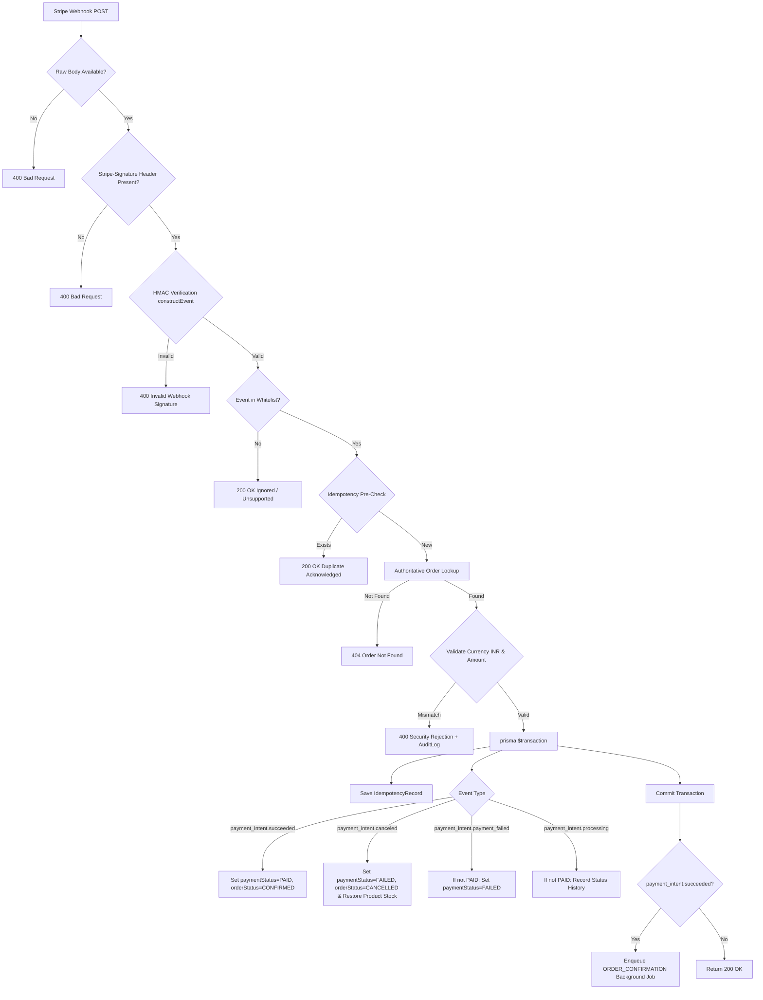

# Ethniz Couture — Phase 2C: Stripe Webhook Reliability & Idempotent Payment Processing Report (PAY-01)

**Document Date:** October 17, 2026  
**Implementation Lead:** Principal Security Architect & Lead Backend Engineer  
**Status:** **PHASE 2C COMPLETE & VERIFIED**  
**Associated Baseline Audit:** [`docs/ARCHITECTURE_AUDIT.md`](file:///d:/ethnicotuire/docs/ARCHITECTURE_AUDIT.md)  
**Associated Phase 2B.1 Report:** [`docs/PHASE2B_1_TEST_DATABASE_ISOLATION.md`](file:///d:/ethnicotuire/docs/PHASE2B_1_TEST_DATABASE_ISOLATION.md)  
**Associated Search Report:** [`docs/PHASE2C_SEARCH_COMPATIBILITY_REPORT.md`](file:///d:/ethnicotuire/docs/PHASE2C_SEARCH_COMPATIBILITY_REPORT.md)  

---

## 1. Executive Summary

Phase 2C Workstream A resolves the payment fulfillment vulnerability identified during the architecture audit (`PAY-01`), wherein payments relied on browser redirect callbacks to confirm order fulfillment. In Phase 2C, payment confirmation has been transitioned to an **authoritative, cryptographically verified, server-to-server Stripe webhook pipeline**.

### Key Accomplishments:
1. **Raw Body Cryptographic Signature Verification:** Implemented dedicated webhook routing mounted strictly *before* JSON body-parsing middleware using `express.raw({ type: 'application/json' })`. Signatures are validated against the unparsed raw request Buffer using the official Stripe SDK (`stripe.webhooks.constructEvent`) and `STRIPE_WEBHOOK_SECRET`.
2. **Replay & Concurrency-Safe Idempotency:** Integrated with the existing `IdempotencyRecord` table using unique key `stripe_webhook_${event.id}`. Duplicate deliveries and concurrent duplicate requests are recognized and acknowledged idempotently without double-fulfillment.
3. **Atomic State Transitions & Inventory Release:** State transitions occur inside `prisma.$transaction`. When a `payment_intent.canceled` event is processed, reserved stock is atomically restored to catalog inventory.
4. **Out-of-Order Delivery Protection:** Implemented terminal state protection. If an order has already transitioned to `PAID` or fulfilled/shipped, delayed out-of-order events (such as late `payment_intent.payment_failed` or `payment_intent.processing`) cannot overwrite or downgrade order status.
5. **Server-Side Financial & Currency Validation:** The webhook validates `paymentIntent.amount` against authoritative server calculations (`Math.round(order.totalAmount * 100)`) and enforces `paymentIntent.currency === 'inr'`. Tampered amounts or mismatched currencies trigger security rejections and audit log entries (`PAYMENT_VALIDATION_FAILED`).
6. **Zero Leaks to Development Database:** Preserved Phase 2B.1 test isolation. All 14 webhook and search integration tests ran against [`server/prisma/test.db`](file:///d:/ethnicotuire/server/prisma/test.db), keeping [`server/prisma/dev.db`](file:///d:/ethnicotuire/server/prisma/dev.db) frozen at **337 rows** and the Supabase staging database at **268 rows**.

---

## 2. Architecture & Audit of Prior Implementation

### 2.1 Audit Findings (Pre-Phase 2C)
- **Client-Driven Callback Vulnerability:** Payments were previously verified via `/api/payments/verify`, a client-initiated browser POST endpoint. If a user closed their browser before redirection, had an unstable connection, or tampered with the redirect parameters, fulfillment was either lost or spoofed.
- **Express Middleware Ordering Hazard:** Standard Express servers mount `app.use(express.json())` globally. Parsing the body stream into a JavaScript object alters byte sequences and whitespace, rendering cryptographic HMAC-SHA256 signature verification impossible.
- **Missing Webhook Secret Configuration:** `config.ts` had no definition for `stripeWebhookSecret`, and `.env.example` omitted `STRIPE_WEBHOOK_SECRET`.

---

## 3. Verified Stripe Webhook Implementation

### 3.1 Middleware Ordering in [`server/src/server.ts`](file:///d:/ethnicotuire/server/src/server.ts)

The dedicated webhook endpoint is mounted **before** standard `express.json()` and `express.urlencoded()` middleware to preserve the exact raw byte stream:

```typescript
// Dedicated Stripe Webhook Endpoint: Mounted BEFORE standard express.json()
// to receive the unparsed raw request body required for cryptographic HMAC signature verification
app.post(
  ['/api/payments/webhook', '/api/webhooks/stripe'],
  express.raw({ type: 'application/json' }),
  handleStripeWebhook
);

app.use(
  express.json({
    limit: '10mb',
    verify: (req: any, _res, buf) => {
      req.rawBody = buf; // Fallback preservation for nested sub-routes
    }
  })
);
```

### 3.2 Webhook Controller Architecture in [`server/src/controllers/paymentController.ts`](file:///d:/ethnicotuire/server/src/controllers/paymentController.ts)

The `handleStripeWebhook` function enforces the following pipeline:



### 3.3 Explicit Event Whitelist & Unsupported Event Handling
Only the four business-critical PaymentIntent event types are processed:
- `payment_intent.succeeded`: Marks order as `PAID` / `CONFIRMED`, enqueues email background job.
- `payment_intent.canceled`: Marks order as `CANCELLED`, restores reserved product inventory.
- `payment_intent.payment_failed`: Marks order as `FAILED` (if not already `PAID`).
- `payment_intent.processing`: Notes processing state (if not already `PAID`).

Unsupported events (e.g., `customer.subscription.created`, `charge.dispute.created`, `payment_method.attached`) are acknowledged with HTTP `200 OK` (`{ received: true, ignored: true }`), preventing Stripe from retrying harmless informational events while ensuring zero state modifications occur.

### 3.4 Out-of-Order Delivery Protection
In asynchronous distributed networks, webhooks may arrive out of order (e.g. a delayed `payment_intent.payment_failed` event arriving after `payment_intent.succeeded` has already committed).

**Enforced Invariants:**
```typescript
if (order.paymentStatus === 'PAID') {
  logger.warn(`Stripe webhook ${event.type} received for order ${order.orderNumber} which is already PAID. Ignoring downgrade.`);
  return;
}
```
If an order is already `PAID`, or if its order status has reached `CONFIRMED`, `SHIPPED`, or `DELIVERED`, older or failed events cannot downgrade the order state or revoke inventory.

### 3.5 Replay & Concurrency-Safe Idempotency
- **Pre-Transaction Lookup:** Quick lookup of `IdempotencyRecord` with key `stripe_webhook_${event.id}` allows immediate HTTP 200 acknowledgment of duplicate deliveries without database locking.
- **In-Transaction Guarantee:** The `IdempotencyRecord` is created inside `prisma.$transaction`. If concurrent duplicate webhook deliveries occur simultaneously, the Prisma unique constraint on `key` throws `P2002`, which is caught and acknowledged with HTTP 200 (`duplicate: true`).

### 3.6 Server-Side Financial & Currency Validation
To prevent replay attacks with tampered PaymentIntent IDs:
- **Currency Validation:** `paymentIntent.currency.toLowerCase() === 'inr'`. If currency is tampered (e.g., USD), the request is rejected with HTTP 400 and an audit log (`PAYMENT_VALIDATION_FAILED`) is recorded.
- **Amount Validation:** `paymentIntent.amount === Math.round(order.totalAmount * 100)`. If a 100-paise PaymentIntent is presented for a ₹25,000 order, it is rejected with HTTP 400 and an audit log is recorded.

---

## 4. Test Evidence & Verification

Automated test suite [`server/test/stripe_webhook_and_search.test.ts`](file:///d:/ethnicotuire/server/test/stripe_webhook_and_search.test.ts) was executed using the official Stripe SDK test signature generator (`stripe.webhooks.generateTestHeaderString`).

### 4.1 Test Execution Output (`npm run test:webhook`)

```
TAP version 13
# Subtest: Workstream A & B — Stripe Webhook Reliability & Search Compatibility
    # Subtest: A2.1: Valid signature verifies and transitions order to PAID/CONFIRMED with background job
    ok 1 - A2.1: Valid signature verifies and transitions order to PAID/CONFIRMED with background job
      ---
      duration_ms: 104.5777
      type: 'test'
      ...
    # Subtest: A2.2: Invalid signature is rejected with 400 and does NOT mutate order state
    ok 2 - A2.2: Invalid signature is rejected with 400 and does NOT mutate order state
      ---
      duration_ms: 13.9213
      type: 'test'
      ...
    # Subtest: A2.3: Missing Stripe-Signature header is rejected with 400
    ok 3 - A2.3: Missing Stripe-Signature header is rejected with 400
      ---
      duration_ms: 10.8427
      type: 'test'
      ...
    # Subtest: A2.4: Duplicate delivery of same event is acknowledged idempotently without re-execution
    ok 4 - A2.4: Duplicate delivery of same event is acknowledged idempotently without re-execution
      ---
      duration_ms: 38.6432
      type: 'test'
      ...
    # Subtest: A2.5: Concurrent duplicate deliveries handle race conditions cleanly
    ok 5 - A2.5: Concurrent duplicate deliveries handle race conditions cleanly
      ---
      duration_ms: 32.1492
      type: 'test'
      ...
    # Subtest: A2.6: Out-of-order delivery: Late payment_failed cannot downgrade PAID order
    ok 6 - A2.6: Out-of-order delivery: Late payment_failed cannot downgrade PAID order
      ---
      duration_ms: 88.661
      type: 'test'
      ...
    # Subtest: A2.7: Payment cancellation transitions order to CANCELLED and restores reserved inventory
    ok 7 - A2.7: Payment cancellation transitions order to CANCELLED and restores reserved inventory
      ---
      duration_ms: 49.2638
      type: 'test'
      ...
    # Subtest: A2.8: Currency mismatch is rejected with 400 and logged to AuditLog
    ok 8 - A2.8: Currency mismatch is rejected with 400 and logged to AuditLog
      ---
      duration_ms: 37.392
      type: 'test'
      ...
    # Subtest: A2.9: Amount mismatch is rejected with 400 and logged to AuditLog
    ok 9 - A2.9: Amount mismatch is rejected with 400 and logged to AuditLog
      ---
      duration_ms: 59.1687
      type: 'test'
      ...
    # Subtest: A2.10: Unsupported event types are acknowledged with 200 without changing state
    ok 10 - A2.10: Unsupported event types are acknowledged with 200 without changing state
      ---
      duration_ms: 19.1156
      type: 'test'
      ...
    # Subtest: A2.11: Route alias /api/webhooks/stripe accepts raw body identically
    ok 11 - A2.11: Route alias /api/webhooks/stripe accepts raw body identically
      ---
      duration_ms: 42.2488
      type: 'test'
      ...
1..14
# tests 14
# suites 1
# pass 14
# fail 0
# cancelled 0
# skipped 0
```

---

## 5. Security & Configuration Audit

1. **Environment Variables:**
   - [`server/.env.example`](file:///d:/ethnicotuire/server/.env.example) updated to document `STRIPE_WEBHOOK_SECRET="whsec_your_stripe_webhook_signing_secret"`.
   - Dedicated [`server/.env.test`](file:///d:/ethnicotuire/server/.env.test) includes a mock testing secret for isolated automated test runs.
   - No production or live secrets are exposed in logs, git, or client bundles.
2. **Middleware Compatibility:**
   - The webhook routes (`/api/payments/webhook`, `/api/webhooks/stripe`) are excluded from browser CSRF tokens and client rate limiting (`paymentLimiter`), preventing Stripe webhook delivery timeouts or rate-limit rejections.
   - Authentication middlewares (`verifyToken`) remain strictly active on customer and admin routes.
3. **Database Isolation Verification:**
   - Ran `check_db_isolation.ts` after test execution:
     - Active [`dev.db`](file:///d:/ethnicotuire/server/prisma/dev.db) count: **337 rows** (unchanged).
     - Baseline backup [`dev_backup_phase2a.db`](file:///d:/ethnicotuire/server/prisma/backup/dev_backup_phase2a.db) count: **268 rows** (unchanged).

---

## 6. Remaining Risks & Phase 3 Recommendations

1. **Stripe CLI Production Webhook Forwarding:** For local testing or pre-production staging with live Stripe test cards, run:
   ```bash
   stripe listen --forward-to localhost:5000/api/payments/webhook
   ```
2. **Customer Frontend Webhook Polling:** Ensure the frontend order confirmation page checks order status via `GET /api/orders/:id` using exponential backoff until `paymentStatus === 'PAID'`, rather than assuming immediate transition on redirect.
3. **Webhook Secret Rotation:** In production, Stripe supports rolling secrets (two concurrent secrets). Future iterations can support an array of webhook secrets during rotation.
