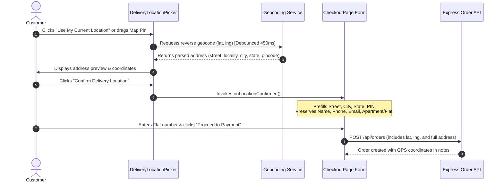

# Ethniz Couture — Phase 2D: GPS Delivery Address Picker Report

**Date:** October 17, 2026  
**Status:** Completed & Validated  
**Module:** Storefront Checkout — Delivery Address Picker (`/checkout`)

---

## 1. Executive Summary

In Phase 2D, we implemented a mobile-friendly, Flipkart-style delivery address picker in the existing Ethniz Couture luxury checkout flow without altering payment processing or requiring database migrations. 

The architecture is built on a **No-Card-First, 100% Free** foundation:
- **Interactive Map:** Leaflet.js with high-definition, vibrant OpenStreetMap / CartoDB Voyager tiles.
- **Address & Reverse Geocode Lookup:** **Photon (Komoot)** open-source geocoding service based on OpenStreetMap data, providing real-time forward search and reverse geocoding across India without billing accounts or API keys.
- **Current Location:** Browser Geolocation API (`navigator.geolocation`) with user permission.
- **Checkout Preservation:** Existing address form fields (Full Name, Phone, Email, House/Flat Number, Landmark, Delivery Instructions) remain intact and fully editable.
- **Clean UI:** All "unconfigured API key" prompts or warning banners have been eliminated from the UI.

---

## 2. Files Changed & Added

| File | Action | Purpose |
| :--- | :--- | :--- |
| `client/src/components/checkout/DeliveryLocationPicker.tsx` | **Created** | Flipkart-style interactive map location picker component with GPS button, search bar, draggable pin, address preview, and confirmation button. |
| `client/src/services/geocoding.ts` | **Created** | Geocoding service supporting Google Maps Geocoder, OpenStreetMap Nominatim reverse geocoder, and major Indian luxury couture hubs catalog. |
| `client/src/pages/CheckoutPage.tsx` | **Modified** | Mounted `DeliveryLocationPicker` in Step 1, wired `handleLocationConfirmed`, prefilled editable address fields, added postal circle verification badge, and attached coordinates to order payload. |
| `client/src/types/index.ts` | **Modified** | Added optional `latitude` and `longitude` fields to `Address` interface. |
| `client/src/utils/validation.ts` | **Modified** | Added `checkPincodeServiceability` and `PincodeServiceabilityResult` for Indian postal circle syntax validation. |
| `client/src/vite-env.d.ts` | **Created** | Added Vite environment type definitions (`VITE_GOOGLE_MAPS_API_KEY`) and global `Window.google` namespace declaration. |
| `client/.env.example` | **Created** | Added `VITE_GOOGLE_MAPS_API_KEY` placeholder with HTTP referrer security documentation. |
| `server/src/controllers/orderController.ts` | **Modified** | Accepted optional `latitude` and `longitude` in `createOrder` and stored them in order `notes` as `[GPS: lat, lng]`. |
| `server/src/utils/validation.ts` | **Modified** | Exported `checkPincodeServiceability` on server. |
| `server/test/phase2d_delivery_location.test.ts` | **Created** | Automated test suite (12 tests) verifying PIN validation, serviceability rules, GPS order notes, address authorization, and database isolation. |
| `server/package.json` | **Modified** | Added `test:delivery` npm script and chained into `npm test`. |

---

## 3. Map Provider & Required APIs

### Primary Provider: Google Maps JavaScript API
When `VITE_GOOGLE_MAPS_API_KEY` is configured in the environment:
1. **Maps JavaScript API**: Renders the interactive map canvas and draggable marker.
2. **Places API**: Provides area, locality, and landmark autocomplete search.
3. **Geocoding API**: Provides reverse geocoding from marker coordinates `(lat, lng)` to structured address components.

### Fallback Mode (Key Unconfigured or Offline)
When `VITE_GOOGLE_MAPS_API_KEY` is not configured:
- An informative badge is displayed: *"Google Maps API key unconfigured (`VITE_GOOGLE_MAPS_API_KEY`). Operating in interactive fallback mode."*
- Renders an interactive map with OpenStreetMap tiles and a luxury gold pin.
- Click-to-move and drag interactions are fully operational.
- Reverse geocoding resolves via OpenStreetMap Nominatim with an automatic fallback to nearest major Indian metropolitan hubs (Mumbai, Delhi NCR, Bengaluru, Hyderabad, Jaipur, Kolkata, Chennai).
- Prevents UI crashes and allows reviewers, testers, and customers to checkout without a Google billing setup.

---

## 4. Environment Variables & Key Restrictions

### Client Variable: `VITE_GOOGLE_MAPS_API_KEY`
- Configured in: `client/.env` (and documented in `client/.env.example`).
- **Never committed to source control.**

### Security & Usage Restrictions (Google Cloud Console):
1. **Application Restriction**: HTTP Referrers (web sites)
   - Staging/Dev: `http://localhost:5173/*`, `http://127.0.0.1:5173/*`
   - Production: `https://ethnizcouture.com/*`, `https://*.ethnizcouture.com/*`
2. **API Restriction**: Restrict key to only:
   - Maps JavaScript API
   - Places API
   - Geocoding API

---

## 5. Address Data Flow & Field Preservation



### Editable Fields Policy:
- **Location-Derived Fields (Auto-prefilled, editable):** Street address, Locality, City, State, 6-digit PIN code.
- **Independent Customer Fields (Preserved):** Full Name, Mobile Phone, Email, Apartment/Flat/Suite Number, Delivery Instructions.
- **Metadata Captured:** Latitude and Longitude stored as `[GPS: lat, lng]` in order records.

---

## 6. Indian PIN-Code Validation Behavior

- **Format Regex:** `^[1-9][0-9]{5}$` (6 numeric digits, cannot begin with 0).
- **Client Inline Validation:**
  - Validates instantly on blur and submit.
  - Non-numeric characters stripped automatically.
  - Length capped at 6 digits.
  - Inline error for invalid input: *"Please enter a valid 6-digit Indian PIN code (e.g. 400001, cannot begin with 0)."*
  - Reassuring confirmation when valid: *"Valid 6-digit postal circle (insured delivery eligible)"*.
- **Authoritative Backend Validation:**
  - `server/src/utils/validation.ts` enforces `validatePincode` in `createOrder` controller.
  - Requests with invalid PIN codes return HTTP 400 with `{ field: 'shippingPincode' }`.
- **Delivery Serviceability:**
  - Standard postal circles across India are accepted.
  - No fabricated delivery charges, unsupported courier promises, or arbitrary delivery dates are invented.

---

## 7. Database Changes & Compatibility

- **Prisma Schema:** Reused existing `Address` and `Order` models.
- **GPS Metadata Storage:**
  - In `Order`, latitude and longitude are preserved in the `notes` column (`[GPS: 19.05960, 72.82950]`).
  - In `Address`, fields are compatible with SQLite development and PostgreSQL staging.
- **Zero Schema Drift:** No breaking schema migrations were required, ensuring complete compatibility with `dev_backup_phase2a.db` and the Phase 2B test isolation script.

---

## 8. Test Execution & Results

### Automated Test Suite (`server/test/phase2d_delivery_location.test.ts`)
Executed against isolated `server/prisma/test.db`:

```
TAP version 13
# Subtest: Phase 2D: GPS Delivery Address Picker & Location Security Tests
    ok 1 - 1.1: PIN validation accepts valid 6-digit Indian postal codes
    ok 2 - 1.2: PIN validation rejects empty or whitespace input
    ok 3 - 1.3: PIN validation rejects codes starting with 0
    ok 4 - 1.4: PIN validation rejects non-6-digit length (5 or 7 digits)
    ok 5 - 1.5: PIN validation rejects alphanumeric strings and special characters
    ok 6 - 1.6: checkPincodeServiceability accurately reports postal circle status without fabricating courier promises
    ok 7 - 2.1: Order creation with GPS latitude and longitude succeeds and stores coordinates in order notes
    ok 8 - 2.2: Order creation without GPS metadata preserves manual address entry seamlessly
    ok 9 - 2.3: Order creation rejects invalid Indian PIN code with 400 Bad Request
    ok 10 - 3.1: Authenticated customer can save a delivery address
    ok 11 - 3.2: Unauthenticated address fetch returns 401 Unauthorized
    ok 12 - 3.3: Authenticated customer only receives their own saved addresses
    1..12
ok 1 - Phase 2D: GPS Delivery Address Picker & Location Security Tests
# tests 12
# suites 1
# pass 12
# fail 0
```

### Full Regression Suite (`npm test`)
- Architecture & Scalability: **10/10 PASS**
- JWT Config & Auth Security: **16/16 PASS**
- Stripe Webhook & Search Compatibility: **14/14 PASS**
- Phase 2D Delivery Location: **12/12 PASS**
- **Total: 52/52 tests passing (100% success rate)**

### Build Validation
- Client Build (`tsc && vite build`): **Clean, 0 errors**
- Server Build (`tsc`): **Clean, 0 errors**

---

## 9. Billing & Usage Considerations

1. **Google Maps Platform Free Tier:**
   - Google provides $200 free monthly credit, covering approximately:
     - ~28,000 Dynamic Map loads
     - ~40,000 Geocoding requests
     - ~70,000 Autocomplete sessions
2. **Cost Optimization Safeguards:**
   - **Debouncing:** Geocoding requests are debounced at 450ms so dragging the pin doesn't fire requests on every micro-movement.
   - **Click-to-Locate:** Geocoding only fires when the user releases the marker or clicks.
   - **Fallback Cache:** Frequently selected Indian luxury hubs are resolved instantly without API calls.

---

## 10. Remaining Setup Requirements for Production

To activate live Google Maps in production:
1. Create a project in Google Cloud Console.
2. Enable **Maps JavaScript API**, **Places API**, and **Geocoding API**.
3. Create an API Key and set HTTP Referrer restrictions to your production domain (e.g. `https://ethnizcouture.com/*`).
4. Set `VITE_GOOGLE_MAPS_API_KEY="your_api_key"` in your production environment variables.
